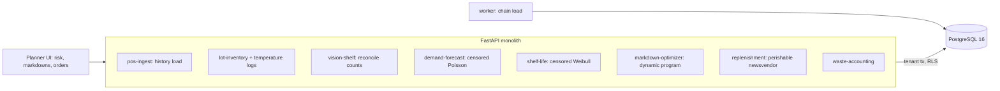

# Grocery Perishables Optimizer

For a grocery chain's fresh departments: it forecasts demand from sales that stop when the shelf is empty, learns how long each
lot really lasts from the heat its logger recorded, says which stock will not sell before it spoils or passes its date, chooses
markdowns day by day, and sets order quantities for the coming days, scoring every decision against what really happened.

Built from blueprint 12 of "Advanced Engineering Build Book, Volume IV" as a **vertical slice**: the demo scenario end to end,
with the platform parts real and the rest listed under [Not built](#not-built-and-why).

**The chain, its sales, lots, temperature logs, weather and shelf camera come from a simulator in this repository; nothing is a
real retailer or real data. The simulator also keeps the truth the data hide (demand on stockout days, each lot's real shelf
life, the real price response, the real weather), which the models never see and every decision is scored against. The models'
forms match the simulator's (log-linear demand, Weibull shelf life), so the errors below are errors of estimation from the data,
not of the wrong model: on real data there would be both.**

## Run it

```bash
docker compose up --build        # migrates, seeds, serves http://localhost:8340/ui/ with one worker
docker compose run --rm test     # 9 tests against a throwaway database (about 15 s)
```

Open http://localhost:8340/ui/ and press **Run all steps** (about 8 seconds), or `make bootstrap demo`.
Demo tokens (local only): `fresh-store_manager-demo`, `fresh-planner-demo`, `fresh-viewer-demo`. Run `make reset` before a second demo run.

## The demo, step by step

1. **Twenty-six weeks of a grocery chain.** Twelve stores, twenty perishable items (berries, greens, dairy, bakery, meat, prepared
   food, produce), 43,680 days of sales and 40,830 lots under the chain's rule: order up to 1.6 times the same weekday's sales of the
   last four weeks. The shelf ran empty on 18.3% of days and 9.5% of demand was never seen; 3.3% of units were thrown out. Fitted on
   22 weeks and scored on the last four against true demand: the censored demand model is off by 7.3% (WAPE), reading sales as demand
   by 11.4%, the chain's same-weekday average by 28.0%. The shelf-life model's Brier score on those weeks' lots is 0.220; the date code
   alone scores 0.378.
2. **Friday: three pallets of strawberries.** 260 packs land at Elm Street with a five-hour refrigeration fault on the logger: 155
   degree-hours above 4 C, a median life of 3.7 days against a 5-day date, a 79% chance the lot spoils before its date. Four other
   deliveries are refused one by one (an unknown item, a zero quantity, an expiry before receipt, a one-reading log). The shelf camera
   counts 244 packs against a system 266, all facings confident, and 22 units of shrink are booked oldest lot first.
3. **What will not sell in time.** With no reorders and no markdowns: the model expects 129 packs of strawberries thrown out by
   Tuesday, the date code alone 99. The truth is 86, because the heatwave nobody has forecast yet sells more of them.
4. **When to mark the strawberries down.** A dynamic program over units on hand plans 40%, 30%, 30%, 20%, then nothing. Against real
   demand and the lot's real life, 1,500 runs each: no markdown makes $159 of gross margin and throws out 89 packs; the clerk's 30% on
   the last day is the same, because the warm lot has spoiled by then; a flat 30% from Saturday makes $288 (3 thrown out); the
   optimiser $282 (3); the optimiser given the true parameters $328. The first two days' discounts are 40% and wait for a store
   manager; the planner's own approval is refused.
5. **A heatwave from Sunday.** The new forecast (36-38 C) lifts the week's strawberry forecast from 196 to 254 (truth 258; last
   month's sales say 181). The six-day plan for all twenty items, on the truth: $6,442 of gross margin, 123 units thrown out, 86.2% of
   demand filled; the chain's rule $5,471, 348 thrown out, 88.0% filled; the same plan without the weather update $6,348.
6. **The audit trail**, in a hash chain.

## Architecture



| Piece | How it works |
|---|---|
| Simulator (`gp/world.py`) | Demand per store, item and day: a base rate times weekday, heat (by category), the weekly flyer and the price response, negative binomial scatter. Each lot's degree-hours above 4 C: usual transit, more on hot days, sometimes a refrigeration fault. Each lot's real life: Weibull around the date code shortened by its exposure. The shelf sells oldest first; lots past their real life are thrown out as spoiled, lots at their date are pulled. History runs the chain's own ordering rule and the occasional last-day markdown. |
| Demand | Poisson regression with a log link on store-item, category x weekday, category x temperature, category x log price and category x flyer. A stockout day contributes P(demand >= sales), not P(demand = sales): the likelihood of censored data, fitted by L-BFGS with an analytic gradient. Negative binomial dispersion from the uncensored days. |
| Shelf life | Weibull per category, log scale = log(date code) + mu - b x exposure/100. A spoiled lot's life lies in its last day; a lot that sold out or was pulled at its date was still good: interval- and right-censored maximum likelihood. Categories with fewer than 30 spoiled lots keep the date code. |
| Markdown | Dynamic program over units on hand, one discount (0-50%) per day: negative binomial demand around the forecast scaled by the fitted price response, sales up to stock, then the largest lot spoils with its hazard; left at the date is pulled. |
| Replenishment | Order up to the service-level quantile of next day's demand, less the stock the shelf-life model expects to survive the day. Each item's service level is the one that earned most when the plan was simulated in the model's own world (its forecast, its fitted lives), never the truth. |
| Scoring | Every option runs hundreds of times against the truth with common random numbers: real demand, real lives, real weather. |
| Platform | Row-level security per chain, Postgres job queue, Idempotency-Key replay, hash-chained audit log, `/metrics`. |

## Data model

`migrations/002_grocery.sql` follows the blueprint (store, sku, inventory_lot, expiration_event, sale, forecast, replenishment_plan,
markdown_action, temperature_sample, waste_event); additions are marked `(+)`: the chain (seed, clock, weather in force), each lot's
exposure, the stockout flag on a sale (the units are a floor on demand), and the approval of deep markdowns.

## API

| Method | Endpoint | Purpose |
|---|---|---|
| POST | `/v1/inventory/lots` | Receive lots with their temperature logs, each checked; exposure from the log |
| GET | `/v1/forecast` | Demand by day: mean and 80% band, without the weather update, the chain rule's number, the truth |
| POST | `/v1/replenishment/solve` | Order-up-to levels for every item, scored with the alternatives on the truth |
| POST | `/v1/markdown/solve` | Discounts by day for an item's stock, scored with the alternatives on the truth |
| GET | `/v1/expiration/risk` | Stock that will not sell in time, by the model, the date code and the truth |
| POST | `/v1/vision/count` | Reconcile a shelf camera's counts; book shrink or send for a manual check |
| POST | `/v1/chain:load` | (+) 202 + job: load the chain and fit the models |
| GET | `/v1/chain` | (+) The chain today |
| POST | `/v1/weather/forecast` | (+) A new weather forecast |
| POST | `/v1/markdown/{id}/approve` | (+) A store manager signs off a deep markdown, never its planner |

Contract: [`docs/openapi.json`](docs/openapi.json).

## Measured

[`docs/evaluation.md`](docs/evaluation.md) (`python -m gp.evaluate`, three chains the demo never uses) and
[`docs/performance.md`](docs/performance.md).

| Component | Result | Baseline |
|---|---|---|
| Demand, four held-out weeks, WAPE | 6.7-7.2% (bias -6%) | sales read as demand 10.6-11.1% (-10%); same weekday 24.8-25.8% |
| Berries price response (true 2.2-2.3) | 1.7-2.4 | sales read as demand 0.9-1.0 |
| Shelf life, Brier score | 0.22-0.23 | date code 0.39-0.42 |
| Lots over 120 degree-hours that spoil before their date | predicted 67-71% | really 76-81% |
| Markdown of an overstocked lot, 9 cases | beat no markdown in 2, matched it in 5, lost in 2; matched or beaten by a flat 30% from day two in 4 | |
| Replenishment through a heatwave, 9 stores | 13-21% more gross margin, 28-55 units thrown out | chain rule 133-339 thrown out, similar fill rate |
| The weather update | $56-354 of margin per store-week, 3-5 points of fill rate | |

What these numbers say plainly. Reading stockouts as censored fixes most, not all, of what sales hide: the model still runs about
6% low on true demand, probably because its censored likelihood assumes Poisson scatter while real demand is wider (not tested here). The shelf-life model is far better than the date code
and still too kind to the warmest lots. The replenishment gain is real and most of it is not clever: it is counting only stock that
will last and forecasting demand rather than last month's capped sales. The markdown optimiser is the weakest piece: its price
response is learned from a few clerks' last-day markdowns, and where that response is wrong or the lot turns out to last, a flat
30% from day two did as well or better (4 of 9 cases); given the true parameters it was best in 7 of 9.

## The hardest tradeoff

What to let the optimiser decide. The program can only be as good as the price response and spoilage hazard it is given, and both
are learned from thin data: markdowns in history are rare and confounded with a lot's last day, and most lots sell out before they
show how long they would have lasted. So every plan is shown with the simple rules beside it, scored on the same draws, and deep
discounts wait for a person. Where the rule wins, the page says so.

## Threat model (summary)

| Threat | Mitigation here | Gap |
|---|---|---|
| A bad delivery record steering orders | Unknown items, zero quantities, impossible dates, too-short or out-of-range temperature logs refused one by one; batch audited | No cross-check against the supplier's advance ship notice |
| A camera miscount erasing stock | Low-confidence facings trigger a manual check, not an adjustment; gaps within tolerance ignored; shrink booked oldest lot first and audited | The detector itself is simulated |
| A deep markdown given away by mistake | 40% or more waits for a store manager, never the planner | No price floor per item |
| One chain seeing another's data | Row-level security on every table; tested through the API and in the database | |

## Not built, and why

- **A vision model**: the shelf camera's per-facing counts and confidences are simulated; the reconciliation logic is real.
- **Real POS, ERP, supplier or weather feeds**: generated instead, so every decision can be scored against the truth.
- **Promotions planning, substitution between items, supplier minimums and pack sizes**: demand is per item; orders are units.
- **A gradient-boosted or deep forecaster**: the censored GLM matches the generator's form; a flexible model would need a censored loss too.
- **Kafka, Flink, Redis, MLflow, OpenTelemetry, Terraform, CI, SSO, a Next.js front end**: not needed to prove the slice; no cloud account used.

## Commercial sketch

Buyer: grocers, convenience chains, food distributors. Pricing shape from the blueprint: per store per month, with waste-reduction
reporting for sustainability teams.

## Layout

```
core/        platform kit: db + RLS, jobs, audit chain, HTTP, scenario runner, load test
gp/          world (chain, demand, lots, shelf), engine (censored demand, shelf life, markdown, replenishment), api, seed, evaluate
migrations/  forward-only SQL          web/   UI, scenario.json, demo.json (recorded run)
tests/       9 tests                   docs/  evaluation.md, performance.md, openapi.json
```
